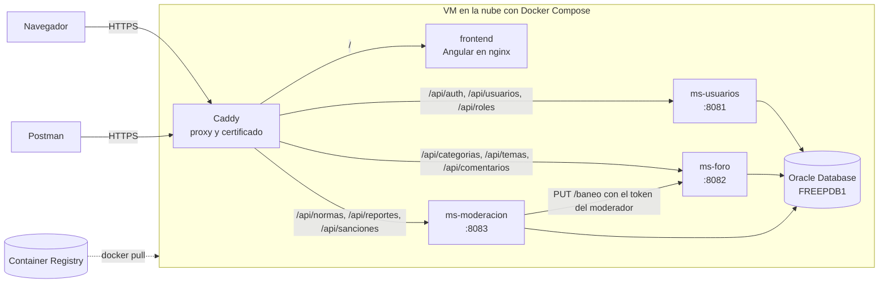
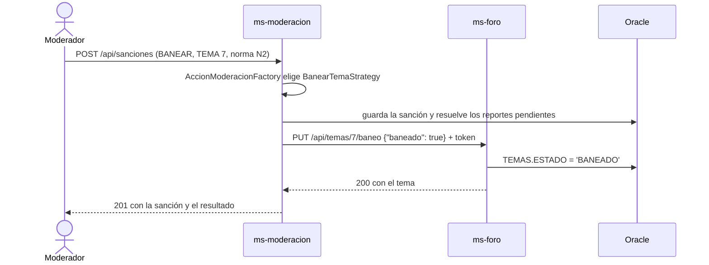

# Ágora Foros

Foro en línea con frontend en Angular y tres microservicios en Spring Boot 3.5 que guardan sus datos en Oracle.
Una persona se registra, inicia sesión, busca temas, los lee, publica y comenta. Si algo no cumple las normas del
foro lo reporta, y un moderador o administrador lo banea.

La versión 2.0.0 agrega el tercer microservicio (`ms-moderacion`), el frontend, un arquetipo Maven del que salen
los tres microservicios y el despliegue con Docker en la nube. En esta versión el frontend y el backend funcionan
por separado: el frontend trabaja con listas en memoria y el backend se prueba con Postman.

## Arquitectura



Cada microservicio tiene su propio esquema en Oracle (`USUARIOS_MS`, `FORO_MS` y `MODERACION_MS`) y ninguno lee las
tablas de otro. Por eso `TEMAS.USUARIO_ID` o `REPORTES.CONTENIDO_ID` no tienen llave foránea hacia el otro esquema.

`ms-usuarios` maneja usuarios, roles e inicio de sesión. El login devuelve un token JWT con el id, el nombre de
usuario y el rol. Los otros dos servicios validan ese token con la misma clave y no le preguntan nada a
`ms-usuarios`, así que siguen atendiendo aunque `ms-usuarios` esté caído. El costo es que un token vale hasta que
expira, dos horas después del login, aunque un administrador bloquee la cuenta entre medio.

`ms-foro` maneja categorías, temas y comentarios. Un tema puede estar `ABIERTO`, `CERRADO` o `BANEADO`, y un
comentario puede estar baneado. Lo baneado responde 404 a quien no es moderador y no recibe comentarios.

`ms-moderacion` es el tercer microservicio del caso. Guarda las normas del foro, los reportes de los usuarios y el
historial de sanciones. Cuando un moderador banea o restaura algo, `ms-moderacion` registra la sanción y llama a
`ms-foro` con el mismo token del moderador, así `ms-foro` sigue aplicando sus propios permisos. La sanción se guarda
dentro de una transacción que termina con esa llamada: si `ms-foro` responde con error, la sanción no queda.



## Roles

| Rol | Qué puede hacer |
|-----|-----------------|
| `USUARIO` | Publica temas y comentarios, edita o borra lo suyo, reporta contenido ajeno y ve o retira sus reportes. |
| `MODERADOR` | Lo mismo que un USUARIO. Además cierra temas, borra contenido ajeno, revisa reportes, banea y restaura temas y comentarios. |
| `ADMIN` | Lo mismo que un MODERADOR. Además administra usuarios, roles, categorías y normas, y corrige o borra sanciones del historial. |

## Arquetipo

`arquetipo/` es un arquetipo Maven (`cl.agora:agora-microservicio-archetype:1.0.0`). Lo armé con lo que
`ms-usuarios` y `ms-foro` tenían en común. Genera un microservicio que ya trae:

- Spring Boot 3.5 con Java 21 y los paquetes `controller`, `service`, `repository`, `model`, `dto`, `hateoas`,
  `exception` y `security`.
- Seguridad sin estado con el token JWT de `ms-usuarios` y el rol en el claim `rol`.
- Errores en JSON con un `@RestControllerAdvice` y respuestas 401 y 403 con el mismo formato.
- Conexión a Oracle por variables de entorno, local o con el Wallet de Oracle Cloud (`ojdbc11` + `oraclepki`).
- Actuator con health checks, un Dockerfile de dos etapas y un test de la seguridad.

Para dejarlo disponible en el equipo, cada persona lo instala una vez en su repositorio Maven local. `mvn install`
también corre la prueba del arquetipo, que genera un proyecto de ejemplo y lo compila con sus tests.

```bash
cd arquetipo && mvn install
```

Después se crea un microservicio nuevo así. Con estos mismos parámetros se generó `ms-moderacion`:

```bash
mvn archetype:generate -DarchetypeGroupId=cl.agora -DarchetypeArtifactId=agora-microservicio-archetype \
  -DarchetypeVersion=1.0.0 -DgroupId=cl.agora -DartifactId=ms-moderacion -Dversion=2.0.0 \
  -Dpackage=cl.agora.moderacion -DnombreServicio=Moderacion -Dpuerto=8083 -DesquemaBd=MODERACION_MS
```

`ms-usuarios` y `ms-foro` existían antes del arquetipo. Los dejé con la misma estructura, configuración y Dockerfile
que genera la plantilla.

## Patrones de diseño

En el backend, las acciones de moderación usan **Strategy** y **Factory** (`ms-moderacion/.../strategy`). Banear un
tema, restaurarlo, banear un comentario y restaurarlo son cuatro estrategias que implementan
`AccionModeracionStrategy`. `AccionModeracionFactory` recibe todas las estrategias que Spring encuentra y entrega la
que corresponde al tipo de contenido y a la acción. `SancionService` no tiene un `if` por cada caso, y una acción nueva
es una clase más. `ForoClient` es la única clase que conoce las rutas de `ms-foro` (un Gateway). El resto sigue lo
que trae el arquetipo: capas MVC, Repository con Spring Data, DTOs con validaciones y ensambladores HATEOAS.

En el frontend uso **Facade** y **Observer** sobre repositorios en memoria. Lo explico en la sección del frontend.

## Frontend

Está en `frontend/`, hecho con Angular 22.3 y Bootstrap 5.3.9 (con bootstrap-icons). Las fuentes Fraunces y Figtree
vienen de npm, así que la página no carga nada de servidores externos. El nombre, el logo (un bocadillo de diálogo con
un pórtico griego), la paleta, la tipografía y las diez ilustraciones son propias. Los colores y las fuentes están
definidos como variables CSS en `src/styles.css`.

Los datos parten de los arreglos de `src/app/data`, que repiten los usuarios, categorías, temas, comentarios, normas,
reportes y sanciones de los scripts de `bd/`. Todo lo que se crea o se cambia vive en memoria mientras la página está
abierta. Si se recarga, vuelve a los datos iniciales. Solo el id de la sesión queda en `sessionStorage`, así que
recargar no cierra la sesión.

Las páginas usan la grilla de 12 columnas de Bootstrap y las revisé en 375, 768 y 1280 px. En celular y tablet el menú
se pliega, y desde los 1200 px se muestra completo.

| Ruta | Página | Acceso |
|------|--------|--------|
| `/` | Inicio con categorías y temas populares | Público |
| `/explorar` | Búsqueda por texto, categoría, autor y estado | Público |
| `/categorias/:id`, `/temas/:id`, `/normas` | Temas de una categoría, detalle con comentarios, normas del foro | Público |
| `/iniciar-sesion`, `/registro`, `/recuperar-contrasena` | Inicio de sesión, registro y recuperación en tres pasos | Sin sesión |
| `/temas/nuevo`, `/temas/:id/editar`, `/mis-temas` | Publicar y editar temas (solo el autor), lista de temas propios | Con sesión |
| `/perfil`, `/perfil/editar` | Ver y modificar el perfil, cambiar la contraseña, eliminar la cuenta | Con sesión |
| `/mis-reportes` | Reportes enviados, en qué quedaron, y retirar los pendientes | Con sesión |
| `/moderacion` | Reportes pendientes, banear y restaurar temas y comentarios | MODERADOR, ADMIN |
| `/admin/usuarios`, `/admin/categorias`, `/admin/normas`, `/admin/sanciones` | Administración de cuentas, categorías y normas, e historial de sanciones (corregir el motivo o borrar un registro) | ADMIN |

En el detalle de un tema cada persona ve las acciones que le corresponden: comentar si el tema está abierto, editar o
cerrar lo propio, reportar lo ajeno, y banear o eliminar si modera. Los guards `authGuard`, `invitadoGuard` y `rolGuard`
protegen las rutas, y las fachadas vuelven a revisar el permiso antes de ejecutar cada acción.

Recuperar contraseña pide el correo, muestra un código de seis dígitos en pantalla porque no hay servidor de correo, y
después pide la nueva contraseña. Como no hay pagos en el caso, no hay ninguna pantalla de pago.

Patrones del frontend:

- Repository. `core/repositories/repositorio-memoria.ts` es la base: guarda el arreglo en un `signal` privado y lo
  reemplaza en cada cambio, nunca lo modifica. Hay un repositorio por entidad (`usuario`, `foro` y `moderacion`).
- Facade. `core/facades/` tiene `AuthFacade`, `ForoFacade`, `ModeracionFacade` y `AdminFacade`. Son lo único que
  inyectan los componentes y concentran las reglas, por ejemplo que nadie reporte su propio contenido o que no se borre
  una categoría con temas. Cada operación devuelve un `Resultado` con el mensaje que se muestra al usuario.
- Observer. Los repositorios exponen signals de solo lectura y las fachadas arman vistas con `computed()`, como
  `usuarioActual`, `temasVisibles` o `cantidadPendientes`. Las plantillas observan esas señales y se actualizan solas.
- Las páginas de `features/` son contenedoras y los componentes de `shared/components` solo reciben datos y emiten
  eventos.

Validaciones: cada formulario es un Reactive Form y repite las reglas en los atributos HTML (`required`, `minlength`,
`maxlength`, `pattern`, `type="email"`), con un mensaje en español bajo cada campo. Los validadores están en
`core/validators/agora.validators.ts`. La contraseña tiene siete reglas y una lista bajo el campo muestra cuáles
faltan: entre 8 y 20 caracteres, una mayúscula, una minúscula, un número, un carácter especial, sin espacios y sin el
nombre de usuario. El nombre de usuario, el correo, las categorías y las normas no se pueden repetir.

```bash
cd frontend
npm install
npm start                    # http://localhost:4200
npm test -- --watch=false    # 44 tests de validadores, fachadas, guards y plurales
npm run build                # dist/agora-web
```

## Estrategia de ramas

Uso GitFlow, la estrategia de la guía con ramas de largo plazo y ramas por tarea:

- `main` tiene solo versiones entregadas, cada una con su tag (`v2.0.0`).
- `develop` junta el trabajo de la versión siguiente.
- `feature/<nombre>` sale de `develop`, tiene una funcionalidad y vuelve a `develop` con un merge.
- `release/<versión>` sale de `develop` cuando la versión está completa. Ahí se ajustan versión y documentación, y
  después se integra a `main` con su tag y de vuelta a `develop`.
- `hotfix/<nombre>` sale de `main` si hay que corregir algo ya entregado.

La guía muestra Trunk Based Development como la mejor opción para microservicios, con un repositorio por servicio y
merges diarios a `main`. Aquí los tres microservicios, el arquetipo y el frontend viven en un solo repositorio, y cada
evaluación es una versión cerrada. Por eso me sirve más GitFlow: `main` queda igual a lo último que entregué mientras
`develop` avanza.

Las ramas de la versión 2.0.0 son `feature/arquetipo`, `feature/foro-baneo`, `feature/servicios-arquetipo`,
`feature/ms-moderacion`, `feature/postman-moderacion`, `feature/docker-cloud`, `feature/frontend-angular`,
`docs/readme-v2`, `fix/revision-v2` (correcciones después de revisar todo contra lo pedido) y `release/2.0.0`.

## Requisitos

- JDK 21 y Maven 3.9 (cada microservicio trae `./mvnw`)
- Node.js 22 y npm, para el frontend
- Docker con Docker Compose
- Postman

## Cómo levantarlo en un equipo

Todo con Docker. El frontend queda en `http://localhost:8080` y los microservicios en los puertos 8081, 8082 y 8083:

```bash
docker compose up -d --build
```

La primera vez el contenedor de Oracle ejecuta los cuatro scripts de `bd/`, que crean los esquemas, las tablas y los
datos de prueba. `docker compose down` borra los contenedores, y con ellos los datos.

Para trabajar en el código, levanta solo la base y corre cada servicio con Maven:

```bash
docker compose up -d oracle
cd ms-usuarios && ./mvnw spring-boot:run      # y lo mismo en ms-foro y ms-moderacion
cd frontend && npm install && npm start       # http://localhost:4200
```

Las variables `DB_URL`, `DB_USER` y `DB_PASSWORD` cambian la conexión. `JWT_SECRET` tiene que ser la misma en los tres
servicios. Sin ella usan una clave de desarrollo y lo avisan en el log. Con el perfil `cloud` esa clave no sirve y el
servicio no arranca. Para revisar los datos con SQL Developer, conéctate a `localhost:1521`, servicio `FREEPDB1`, con
`USUARIOS_MS` / `AgoraUsr#2026`, `FORO_MS` / `AgoraForo#2026` o `MODERACION_MS` / `AgoraMod#2026`.

## Despliegue en la nube

La nube es una VM de Azure con Docker. Las imágenes se publican en Azure Container Registry y la VM solo las
descarga: no compila nada. `deploy/docker-compose.yml` levanta Oracle, los tres microservicios, el frontend y Caddy, que
saca el certificado HTTPS y reparte las rutas por prefijo según el diagrama de arriba. Los microservicios corren con el
perfil `cloud`, que exige una clave JWT propia.

Con el nombre DNS del paso 1, la URL pública queda en https://agora-foros.eastus2.cloudapp.azure.com. El estado de
cada microservicio se ve en `/salud/usuarios`, `/salud/foro` y `/salud/moderacion`.

1. Crear el registry y la VM, en este caso en la región `eastus2`:

   ```bash
   az group create -n rg-agora-foros -l eastus2
   az acr create -g rg-agora-foros -n agoraforos --sku Basic
   az vm create -g rg-agora-foros -n vm-agora-foros --image Ubuntu2404 --size Standard_B2s \
     --admin-username azureuser --ssh-key-values ~/.ssh/id_ed25519.pub \
     --public-ip-sku Standard --public-ip-address-dns-name agora-foros
   az vm open-port -g rg-agora-foros -n vm-agora-foros --port 80,443 --priority 900
   ```

2. Publicar las imágenes desde el equipo de desarrollo. El script las construye para `linux/amd64`, aunque el equipo
   sea un Mac con chip ARM:

   ```bash
   az acr login --name agoraforos
   deploy/publicar-imagenes.sh agoraforos.azurecr.io 2.0.0
   ```

3. En la VM: instalar Docker, clonar el repositorio, completar `deploy/.env` a partir de `deploy/.env.example` y
   levantar todo. La VM inicia sesión en el registry con un token de solo lectura:

   ```bash
   curl -fsSL https://get.docker.com | sudo sh && sudo usermod -aG docker $USER   # y volver a entrar
   git clone https://github.com/TomasMurua/agora-foros.git && cd agora-foros/deploy
   cp .env.example .env && nano .env
   docker login agoraforos.azurecr.io
   docker compose pull && docker compose up -d
   ```

4. Para actualizar, se publican imágenes nuevas y en la VM se corre `docker compose pull && docker compose up -d`.

Con `COMPOSE_PROFILES=oracle-local` en `deploy/.env`, la base de datos corre como un contenedor más de la VM, con un
volumen para que los datos sobrevivan a los reinicios. El puerto 1521 no queda expuesto a internet. Para revisarla desde
la VM:

```bash
docker compose exec oracle sqlplus 'MODERACION_MS/"AgoraMod#2026"@//localhost/FREEPDB1'
```

Para usar Oracle Cloud (Autonomous Database):

1. Crear la base y ejecutar los scripts de `bd/` en orden, conectado como ADMIN (por ejemplo desde Database Actions).
   `01_crear_esquemas.sql` crea los usuarios en el tablespace por defecto de la base, que en Autonomous es `DATA`, y
   sus claves cumplen las reglas de Autonomous.
2. Descargar el Wallet de la base y descomprimirlo en `deploy/wallet/`.
3. En `deploy/.env`, borrar `COMPOSE_PROFILES`, `ORACLE_PASSWORD` y la `DB_URL` local, y poner la del Wallet:

   ```
   DB_URL=jdbc:oracle:thin:@<nombre_de_la_base>_high?TNS_ADMIN=/wallet
   ```

Sin el perfil `oracle-local`, el compose no levanta el contenedor de Oracle y los microservicios se conectan con el
Wallet, que queda montado en `/wallet`. Ya traen `oraclepki`, la librería que lo lee.

## Postman

`postman/Agora-Foros.postman_collection.json` tiene 120 solicitudes con 269 pruebas sobre los tres microservicios.
Hay dos entornos: `Agora-Foros-local` apunta a los puertos 8081, 8082 y 8083, y `Agora-Foros-nube` apunta a la URL
pública. Se importan la colección y el entorno, se ejecuta primero la carpeta Autenticación, que guarda los tokens, y
después cualquier otra. La colección completa también corre en el Collection Runner o con newman:

```bash
npx newman run postman/Agora-Foros.postman_collection.json -e postman/Agora-Foros-local.postman_environment.json
```

La carpeta de `ms-moderacion` crea un tema y un comentario, los reporta, los banea, los restaura y al final borra todo
lo que creó, incluidos sus reportes y sanciones. Por eso la colección se puede correr varias veces seguidas y la base
queda con los mismos datos iniciales.

Los tests unitarios se corren con `./mvnw test` en cada microservicio y con `npm test` en el frontend.

## Usuarios de prueba

| Usuario | Correo | Contraseña | Rol |
|---------|--------|------------|-----|
| admin | admin@agoraforos.cl | Admin2026! | ADMIN |
| moderador | moderador@agoraforos.cl | Moder2026! | MODERADOR |
| camila.diaz | camila.diaz@correo.cl | Usuario2026! | USUARIO |
| matias.soto | matias.soto@correo.cl | Usuario2026! | USUARIO |
| fernanda.lagos | fernanda.lagos@correo.cl | Usuario2026! | USUARIO |

## Endpoints

Donde la columna Acceso dice "Con sesión" o nombra un rol, hay que mandar el header `Authorization: Bearer <token>`
con el token del login. En la nube todas las rutas cuelgan del mismo dominio.

### ms-usuarios, `http://localhost:8081`

| Método | Ruta | Qué hace | Acceso |
|--------|------|----------|--------|
| POST | `/api/auth/login` | Inicia sesión con nombre de usuario o correo y devuelve el token | Público |
| POST | `/api/usuarios` | Registra un usuario. Un ADMIN con sesión puede indicar `rolId` | Público |
| GET | `/api/usuarios?rol=` | Lista usuarios. El filtro por rol es opcional | ADMIN, MODERADOR |
| GET | `/api/usuarios/me` | Devuelve la cuenta que inició sesión | Con sesión |
| GET | `/api/usuarios/{id}` | Devuelve un usuario | La propia cuenta, ADMIN, MODERADOR |
| PUT | `/api/usuarios/{id}` | Modifica datos. Solo un ADMIN cambia `rolId` y `activo` | La propia cuenta, ADMIN |
| DELETE | `/api/usuarios/{id}` | Elimina la cuenta | La propia cuenta, ADMIN |
| GET | `/api/roles`, `/api/roles/{id}` | Lista los roles o devuelve uno | Público |
| POST, PUT, DELETE | `/api/roles`, `/api/roles/{id}` | Crea, modifica o elimina roles | ADMIN |

### ms-foro, `http://localhost:8082`

| Método | Ruta | Qué hace | Acceso |
|--------|------|----------|--------|
| GET | `/api/categorias`, `/api/categorias/{id}` | Lista las categorías o devuelve una | Público |
| GET | `/api/categorias/{id}/temas` | Lista los temas de una categoría | Público |
| POST, PUT, DELETE | `/api/categorias`, `/api/categorias/{id}` | Crea, modifica o elimina categorías | ADMIN |
| GET | `/api/temas?q=&categoriaId=&autor=&estado=` | Busca temas. Todos los filtros son opcionales | Público |
| GET | `/api/temas/populares?limite=5` | Lista los temas más vistos | Público |
| GET | `/api/temas/{id}` | Devuelve un tema y le suma una visita | Público |
| POST | `/api/temas` | Publica un tema | Con sesión |
| PUT | `/api/temas/{id}` | El autor cambia título, contenido o categoría. Autor, MODERADOR o ADMIN lo abren o cierran | Con sesión |
| PUT | `/api/temas/{id}/baneo` | Banea (`true`) o restaura (`false`) el tema. Lo usa `ms-moderacion` | MODERADOR, ADMIN |
| DELETE | `/api/temas/{id}` | Elimina el tema junto con sus comentarios | Autor, MODERADOR, ADMIN |
| GET | `/api/temas/{id}/comentarios` | Lista los comentarios de un tema | Público |
| POST | `/api/temas/{id}/comentarios` | Comenta un tema abierto | Con sesión |
| GET | `/api/comentarios/{id}` | Devuelve un comentario | Público |
| PUT | `/api/comentarios/{id}` | Edita el comentario | Autor |
| PUT | `/api/comentarios/{id}/baneo` | Banea o restaura el comentario. Lo usa `ms-moderacion` | MODERADOR, ADMIN |
| DELETE | `/api/comentarios/{id}` | Elimina el comentario | Autor, MODERADOR, ADMIN |

Lo baneado solo aparece en las consultas de un MODERADOR o ADMIN. Para los demás responde 404.

### ms-moderacion, `http://localhost:8083`

| Método | Ruta | Qué hace | Acceso |
|--------|------|----------|--------|
| GET | `/api/normas?soloActivas=`, `/api/normas/{id}` | Lista las normas del foro o devuelve una | Público |
| POST, PUT | `/api/normas`, `/api/normas/{id}` | Crea o modifica una norma. Con `activa: false` se desactiva | ADMIN |
| DELETE | `/api/normas/{id}` | Elimina una norma que no aparece en reportes ni sanciones | ADMIN |
| POST | `/api/reportes` | Reporta un tema o comentario e indica la norma. Revisa en `ms-foro` que exista | Con sesión |
| GET | `/api/reportes/mios` | Reportes de quien inició sesión | Con sesión |
| GET | `/api/reportes?estado=&tipo=&contenidoId=` | Bandeja de reportes | MODERADOR, ADMIN |
| GET | `/api/reportes/{id}` | Devuelve un reporte | Autor, MODERADOR, ADMIN |
| PUT | `/api/reportes/{id}` | Cierra el reporte como `RESUELTO` o `DESCARTADO` | MODERADOR, ADMIN |
| DELETE | `/api/reportes/{id}` | Elimina un reporte. El autor puede retirar el suyo mientras está pendiente | Autor, ADMIN |
| POST | `/api/sanciones` | Banea o restaura un tema o comentario en `ms-foro` y registra la sanción. Al banear resuelve los reportes pendientes de ese contenido | MODERADOR, ADMIN |
| GET | `/api/sanciones?tipo=&contenidoId=&accion=` | Historial de sanciones | MODERADOR, ADMIN |
| GET | `/api/sanciones/{id}` | Devuelve una sanción | MODERADOR, ADMIN |
| PUT | `/api/sanciones/{id}` | Corrige el motivo o la norma. No vuelve a ejecutar la acción | ADMIN |
| DELETE | `/api/sanciones/{id}` | Borra la sanción del historial. No deshace el baneo | ADMIN |

Ejemplo de baneo:

```json
POST /api/sanciones
{
  "tipoContenido": "TEMA",
  "contenidoId": 2,
  "accion": "BANEAR",
  "normaId": 2,
  "motivo": "Publicidad de un servidor pagado",
  "reporteId": 1
}
```

### Errores

Todos los errores vuelven en JSON con esta forma:

```json
{
  "timestamp": "2026-11-21T22:36:16.872554",
  "status": 400,
  "error": "Bad Request",
  "mensaje": "La solicitud tiene datos inválidos",
  "ruta": "/api/reportes",
  "detalles": { "motivo": "El motivo debe tener entre 10 y 300 caracteres" }
}
```

| Código | Cuándo aparece |
|--------|----------------|
| 400 | Faltan datos o vienen con un formato inválido, se intenta banear sin indicar la norma o reportar contenido propio |
| 401 | No hay token, el token no sirve o la contraseña no coincide |
| 403 | El rol no tiene permiso o la cuenta está bloqueada |
| 404 | El recurso no existe, o está baneado y quien consulta no modera |
| 409 | Datos repetidos, comentario en un tema cerrado o baneado, reporte ya revisado o contenido que ya estaba baneado |
| 503 | `ms-moderacion` no pudo contactar a `ms-foro` |

## Estructura del repositorio

```
agora-foros/
├── arquetipo/          arquetipo Maven de los microservicios
├── bd/                 scripts de Oracle: esquemas, tablas y datos de los tres servicios
├── deploy/             despliegue en la nube: compose, Caddyfile y script para publicar imágenes
├── docker/initdb/      carga los scripts al crear el contenedor de Oracle
├── docker-compose.yml  todo el sistema en un equipo
├── frontend/           aplicación Angular
├── ms-usuarios/        usuarios, roles e inicio de sesión
├── ms-foro/            categorías, temas y comentarios
├── ms-moderacion/      normas, reportes y sanciones
└── postman/            colección y entornos de Postman
```

## Autor

Tomas Murua Peixoto
